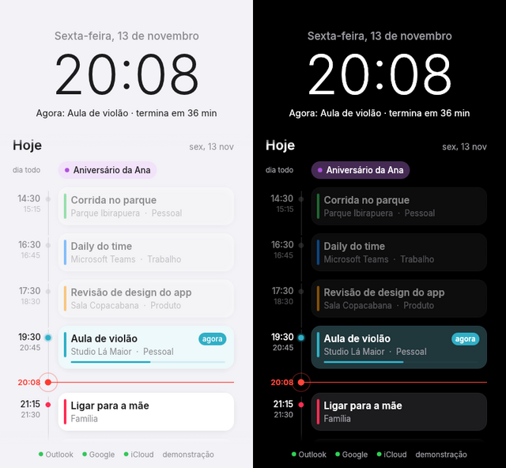

# Linha

A linha do tempo do seu dia, num relance. Quando o computador **desperta** (ou quando você faz login), o Linha aparece com um fade suave mostrando a hora, o que está acontecendo agora e o que vem a seguir — juntando **Outlook / Microsoft 365**, **Google Agenda (Gmail)** e **iCloud** numa lista só.

Escrito em Rust com [egui](https://github.com/emilk/egui), visual inspirado no iOS, fonte Inter embutida, claro/escuro automático.




## O que ele faz

- Relógio grande estilo tela de bloqueio, data por extenso e um resumo: *"Agora: Aula de violão · termina em 36 min"* ou *"Próximo: Daily · em 12 min"* (fica laranja quando faltam ≤ 15 min).
- Linha do tempo de hoje e amanhã (configurável): eventos passados esmaecidos, evento em andamento destacado com selo **agora** e barra de progresso, linha vermelha marcando a hora atual.
- Eventos de dia inteiro como “pílulas” coloridas. Cada evento usa a cor do calendário de origem.
- Animações: a janela entra com fade, o relógio cresce levemente, os cartões sobem um a um em cascata, a linha do “agora” se desenha da esquerda para a direita e pulsa duas vezes; ao fechar, tudo some com fade. Eventos novos que chegam numa sincronização aparecem com fade próprio.
- Sincroniza em segundo plano; se uma conta falhar, os eventos antigos dela continuam na tela e a bolinha da conta fica vermelha (passe o mouse para ver o erro).
- Ignora eventos cancelados e convites que você recusou.

## Compilar

Precisa do Rust (https://rustup.rs).

```bash
cargo build --release
# o executável fica em target/release/linha  (linha.exe no Windows)
```

No Linux, para rodar é preciso ter OpenGL e `libxkbcommon` (já vêm em qualquer desktop comum). Para testar a interface sem conectar nada:

```bash
./target/release/linha demo
```

## Uso

```text
linha                     abre a linha do tempo
linha demo                abre com uma agenda de exemplo
linha daemon              roda em segundo plano: sincroniza e abre ao despertar
linha config              cria/mostra o arquivo de configuração
linha login <conta>       conecta outlook | google | icloud
linha logout <conta>      esquece o login de uma conta
linha sync                sincroniza agora e lista os eventos no terminal
linha autostart on|off    inicia o daemon junto com o sistema
```

Na janela: **Esc** fecha, **Ctrl/Cmd + R** ou **F5** sincroniza, arraste pelo topo para mover. Os botões ⟳ e × aparecem quando o mouse está sobre a janela.

### Fazer aparecer quando o computador desperta

```bash
linha autostart on
```

Isso registra `linha daemon` para iniciar com o sistema (Linux: `~/.config/autostart`, macOS: LaunchAgent, Windows: chave *Run* do registro). O daemon:

1. abre a linha do tempo no login (desligue com `abrir_ao_iniciar = false`);
2. sincroniza a cada `intervalo_sync_min` minutos;
3. percebe que o computador **voltou do sono** e abre a janela de novo, já sincronizando.

A detecção funciona igual nos três sistemas, sem APIs específicas: uma thread dorme 5 s por vez e, se o relógio de parede andou bem mais do que isso (`limiar_sono_seg`), é porque a máquina estava suspensa. Se a janela já estiver aberta, ela só toca a animação de entrada de novo.

## Conectar as contas

Rode `linha config` para criar o arquivo e ver onde ele fica. Ative as contas que quiser (`ativo = true`) e siga os passos abaixo. Depois, `linha sync` mostra no terminal se deu tudo certo.

### Outlook / Microsoft 365 / Hotmail

O login usa o fluxo de “código de dispositivo” da Microsoft, então você precisa de um *client ID* próprio (gratuito, uma vez só):

1. Entre em https://entra.microsoft.com → **Aplicativos → Registros de aplicativo → Novo registro**.
2. Nome: `Linha`. Tipos de conta: **contas em qualquer diretório organizacional e contas Microsoft pessoais**. Registrar.
3. Em **Autenticação**, ative **Permitir fluxos de clientes públicos**.
4. Em **Permissões de API**, confira que há *Microsoft Graph → Delegada → `Calendars.Read`* (adicione se faltar).
5. Copie o **ID do aplicativo (cliente)** para `client_id` em `[outlook]`.
6. `linha login outlook` — o navegador abre em microsoft.com/devicelogin; digite o código mostrado no terminal.

> Em contas de empresa, o administrador pode precisar aprovar o app.

### Google Agenda (Gmail)

1. Em https://console.cloud.google.com crie um projeto e ative a **Google Calendar API**.
2. Configure a tela de consentimento OAuth (tipo *Externo*) e adicione seu e-mail como usuário de teste.
3. Crie um **ID do cliente OAuth** do tipo **App para computador** e copie o *client ID* e o *client secret* para `[google]`.
4. `linha login google` — o navegador abre, você autoriza e pronto (o retorno é capturado em `127.0.0.1`, com PKCE).

> Enquanto o app estiver em modo “Teste” no Google, o login expira a cada 7 dias. Para uso pessoal contínuo, publique o app (o Google mostra um aviso de “app não verificado” que você pode aceitar).

### iCloud

1. Em https://account.apple.com → **Entrar e segurança → Senhas de app**, gere uma senha (precisa ter autenticação de dois fatores).
2. Preencha `apple_id` e `senha_app` em `[icloud]`.
3. `linha login icloud` — testa a conexão e lista seus calendários.

O iCloud é lido via CalDAV. O Linha pede ao servidor para expandir eventos recorrentes e, se ele não expandir, expande localmente (diário, semanal, mensal, anual com `INTERVAL`, `COUNT`, `UNTIL`, `BYDAY`, `BYMONTHDAY`, `BYMONTH`, exceções e datas removidas).

## Configuração

| chave | padrão | o que faz |
|---|---|---|
| `dias` | `2` | quantos dias mostrar a partir de hoje |
| `intervalo_sync_min` | `10` | intervalo de sincronização |
| `fechar_apos_seg` | `0` | fecha sozinha após N s parada (0 = nunca) |
| `tema` | `"sistema"` | `"sistema"`, `"claro"` ou `"escuro"` |
| `sempre_no_topo` | `true` | janela por cima das outras |
| `abrir_ao_iniciar` | `true` | abre quando o daemon inicia |
| `limiar_sono_seg` | `30` | “sumiço” do relógio que conta como sono |
| `cantos_arredondados` | `true` | janela transparente com cantos de 24 px; use `false` no Linux sem compositor |

## Privacidade

- Tudo é **somente leitura** e fica na sua máquina. Nenhum servidor intermediário.
- Tokens OAuth e o cache de eventos ficam na pasta de dados do usuário com permissão `0600` (Unix).
- A senha de app do iCloud fica no `config.toml` (também `0600`). Ela pode ser revogada a qualquer momento no site da Apple.

## Estrutura

```text
src/
  main.rs            comandos de terminal
  config.rs          config.toml
  model.rs           Evento, origem, cache
  store.rs           caminhos, escrita atômica, tokens
  sync.rs            sincroniza as contas em paralelo
  daemon.rs          segundo plano, detecção de despertar, início automático
  demo.rs            agenda de exemplo
  providers/
    outlook.rs       Microsoft Graph (device code)
    google.rs        Google Calendar API (OAuth + PKCE em loopback)
    icloud.rs        CalDAV
    ics.rs           leitor iCalendar + recorrências (com testes)
  ui/
    mod.rs           janela, cabeçalho, rodapé, fades de entrada/saída
    timeline.rs      dias, cartões, linha do “agora”, cascata
    theme.rs         cores do iOS, fontes Inter
    anim.rs          curvas de animação
    fmt.rs           datas em português
```

`cargo test` roda os testes do leitor iCalendar.

Para lançar uma nova versão, veja [docs/RELEASE.md](docs/RELEASE.md).

A fonte Inter (assets/fonts) é distribuída sob a SIL Open Font License — veja `assets/fonts/LICENSE-Inter.txt`.
# Linha
