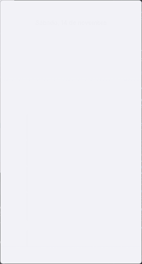

# Linha

A linha do tempo do seu dia, num relance. Quando o computador **desperta** (ou quando você faz login), o Linha aparece com um fade suave mostrando a hora, o que está acontecendo agora e o que vem a seguir — juntando **Outlook / Microsoft 365**, **Google Agenda (Gmail)** e **iCloud** numa lista só.

Escrito em Rust com [egui](https://github.com/emilk/egui), visual inspirado no iOS, fonte Inter embutida, claro/escuro automático.




## O que ele faz

- Relógio grande estilo tela de bloqueio, data por extenso e um resumo: *"Agora: Aula de violão · termina em 36 min"* ou *"Próximo: Daily · em 12 min"* (fica laranja quando faltam ≤ 15 min).
- Linha do tempo de hoje e amanhã (configurável): eventos passados esmaecidos, evento em andamento destacado com selo **agora** e barra de progresso, linha vermelha marcando a hora atual.
- Eventos de dia inteiro como “pílulas” coloridas. Cada evento usa a cor do calendário de origem.
- Animações: a janela entra com fade, o relógio cresce levemente, os cartões sobem um a um em cascata, a linha do “agora” se desenha da esquerda para a direita e pulsa duas vezes; ao fechar, tudo some com fade. Eventos novos que chegam numa sincronização aparecem com fade próprio.
- Sincroniza em segundo plano; se uma conta falhar, os eventos antigos dela continuam na tela e a bolinha da conta fica vermelha (passe o mouse para ver o erro).
- Ignora eventos cancelados e convites que você recusou.

## Compilar

Precisa do Rust (https://rustup.rs).

```bash
cargo build --release
# o executável fica em target/release/linha  (linha.exe no Windows)
```

No Linux, para rodar é preciso ter OpenGL e `libxkbcommon` (já vêm em qualquer desktop comum). Para testar a interface sem conectar nada:

```bash
./target/release/linha demo
```

## Uso

Abra o Linha e clique na **engrenagem** (ou em *Abrir Ajustes* na primeira vez). Tudo se configura por lá: contas, quantos dias mostrar, tema, iniciar com o sistema etc. As mudanças são gravadas na hora.

Na janela: **Esc** fecha (nos Ajustes e no Novo evento, volta), **Ctrl/Cmd + N** cria um evento, **Ctrl/Cmd + R** ou **F5** sincroniza, arraste pelo topo para mover. O **+** fica no canto esquerdo; os botões ⚙ ⟳ × aparecem quando o mouse está sobre a janela.

### No Windows: área de notificação

No Windows o Linha fica na **área de notificação**, ao lado do relógio. Clique no ícone e a linha do tempo sobe no canto da tela, acima da barra de tarefas, como o calendário do Windows. Clicou fora, ela some. O app fica carregado, então abrir é instantâneo. Clique com o botão direito no ícone para abrir os Ajustes ou sair. Com *Iniciar com o sistema* ligado, o ícone aparece sozinho ao entrar no Windows.

### Criar eventos

Escolha um **calendário principal** em *Ajustes → Calendário principal* (ou na primeira vez que criar um evento). O **+** abre a tela *Novo evento*: título, local, dia (com calendário), horário ou dia inteiro. O evento é criado no principal, mas dá para escolher outro calendário na hora. Funciona com Outlook, Google e iCloud.

Pelo terminal também dá:

```text
linha                     abre a linha do tempo
linha ajustes             abre direto nos Ajustes
linha demo                abre com uma agenda de exemplo
linha daemon              roda em segundo plano: sincroniza e abre ao despertar
linha sync                sincroniza agora e lista os eventos no terminal
linha login <conta>       conecta outlook | google pelo navegador
linha logout <conta>      desconecta outlook | google | icloud
linha autostart on|off    inicia o daemon junto com o sistema
linha pasta               mostra onde ficam as configurações
```

### Fazer aparecer quando o computador desperta

Ative **Ajustes → Inicialização → Iniciar com o sistema**. Isso registra `linha daemon` para iniciar com o sistema (Linux: `~/.config/autostart`, macOS: LaunchAgent, Windows: chave *Run* do registro) e já o inicia. O daemon:

1. abre a linha do tempo no login (opção *Mostrar a linha do tempo ao entrar*);
2. sincroniza no intervalo escolhido;
3. percebe que o computador **voltou do sono** e abre a janela de novo, já sincronizando.

A detecção funciona igual nos três sistemas, sem APIs específicas: uma thread dorme 5 s por vez e, se o relógio de parede andou bem mais do que isso (*Considerar suspensão após*), é porque a máquina estava suspensa. Se a janela já estiver aberta, ela só toca a animação de entrada de novo.

### Atualizações

O Linha procura uma versão nova nas releases do GitHub logo depois de iniciar e a cada 6 horas. Se houver, baixa o executável da sua plataforma, confere o SHA-256 publicado junto e troca o arquivo. No Windows a troca entra em vigor na próxima vez que a janela se esconder ou que você clicar no ícone; no macOS/Linux, o processo em segundo plano reinicia sozinho. Dá para desligar ou procurar na hora em *Ajustes → Atualizações*. Se o Linha estiver numa pasta sem permissão de escrita (ex.: `Arquivos de Programas`), a atualização avisa e não faz nada.

## Conectar as contas

Em **Ajustes → Contas**:

- **Outlook / Microsoft 365 / Hotmail** e **Google Agenda (Gmail)**: clique em **Conectar**. O navegador abre na página de login da Microsoft ou do Google; depois de autorizar, a aba mostra “Pronto ✓” e a conta aparece como conectada. Por baixo é OAuth 2.0 com PKCE e retorno capturado em `127.0.0.1`. O Linha pede permissão para ler a agenda e criar eventos; ele nunca altera nem apaga o que já existe.
- **iCloud**: a Apple não oferece login por navegador para agendas. Gere uma **senha de app** em account.apple.com → *Entrar e segurança → Senhas de app* (o link está nos Ajustes), informe o Apple ID e a senha e clique em **Conectar**. O iCloud é lido via CalDAV; eventos recorrentes são expandidos pelo servidor ou, se ele não expandir, localmente (diário, semanal, mensal, anual com `INTERVAL`, `COUNT`, `UNTIL`, `BYDAY`, `BYMONTHDAY`, `BYMONTH`, exceções e datas removidas).

Cada conta conectada pode ser escondida da linha do tempo sem desconectar. **Desconectar** apaga os tokens do computador.

> Para quem mantém o projeto: os apps OAuth da Microsoft e do Google são embutidos no build. Veja [docs/OAUTH.md](docs/OAUTH.md).

## Onde ficam os dados

| sistema | configuração | tokens e cache |
|---|---|---|
| Windows | `%APPDATA%\Linha\config\config.toml` | `%APPDATA%\Linha\data` |
| macOS | `~/Library/Application Support/Linha/config.toml` | `~/Library/Application Support/Linha` |
| Linux | `~/.config/linha/config.toml` | `~/.local/share/linha` |

Os botões *Abrir pasta* nos Ajustes levam direto até elas. O `config.toml` é gerado pelos Ajustes; não é preciso editá-lo.

## Privacidade

- O Linha lê suas agendas e só escreve quando você cria um evento. Nada passa por servidores intermediários.
- Tokens OAuth, a configuração e o cache de eventos são gravados com permissão `0600` (Unix).
- A senha de app do iCloud fica no `config.toml`. Ela pode ser revogada a qualquer momento no site da Apple; *Desconectar* a apaga do computador.

## Estrutura

```text
src/
  main.rs            comandos de terminal
  config.rs          preferências (config.toml) e IDs OAuth embutidos
  model.rs           Evento, origem, cache
  store.rs           pastas do usuário, escrita atômica, tokens
  sync.rs            sincroniza as contas em paralelo
  daemon.rs          segundo plano, detecção de despertar, início automático
  update.rs          atualização automática pelas releases do GitHub
  demo.rs            agenda de exemplo
  providers/
    oauth.rs         login pelo navegador (authorization code + PKCE, loopback)
    outlook.rs       Microsoft Graph
    google.rs        Google Calendar API
    icloud.rs        CalDAV
    ics.rs           leitor iCalendar + recorrências (com testes)
  ui/
    mod.rs           janela, cabeçalho, rodapé, fades de entrada/saída
    settings.rs      tela de Ajustes
    compose.rs       tela Novo evento
    shell.rs         Windows: ícone na área de notificação e janela tipo flyout
    timeline.rs      dias, cartões, linha do “agora”, cascata
    theme.rs         cores do iOS, fontes Inter
    anim.rs          curvas de animação
    fmt.rs           datas em português
```

`cargo test` roda os testes do leitor iCalendar.

Para lançar uma nova versão, veja [docs/RELEASE.md](docs/RELEASE.md).

A fonte Inter (assets/fonts) é distribuída sob a SIL Open Font License — veja `assets/fonts/LICENSE-Inter.txt`.
# Linha
